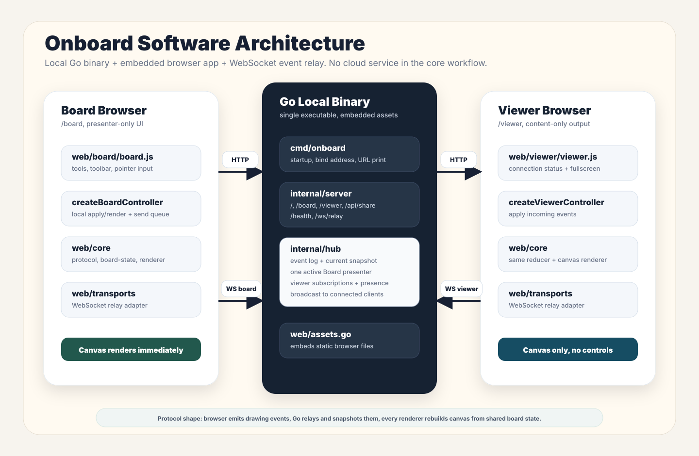
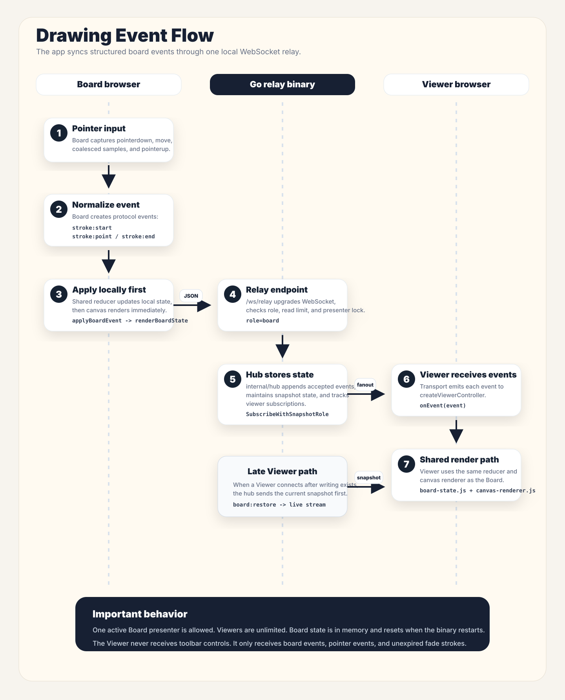

# Software Architecture

Onboard has one supported runtime path: a local Go binary that serves the web
app and relays drawing events over WebSocket.

## Component Diagram



## Event Flow Infographic



## Runtime Responsibilities

The app is split into three runtime areas:

- **Board browser:** owns the presenter UI, pointer input, local rendering,
  tool state, offline queue, and outgoing drawing events.
- **Go binary:** owns HTTP routes, embedded static files, the WebSocket relay,
  presenter lock, viewer presence, in-memory board state, and snapshots.
- **Viewer browser:** owns content-only rendering, connection feedback,
  fullscreen behavior, and incoming event application.

## Main Modules

```text
cmd/onboard
  starts the Go server and prints local/LAN URLs

internal/server
  serves /, /board, /viewer, /api/share, /health, /ws/relay

internal/hub
  keeps bounded board state, presenter ownership, viewer count, and broadcasts

web/board
  presenter controller: tools, pointer input, local apply/render, sends events

web/viewer
  viewer controller: receives events, applies state, renders canvas only

web/core
  shared protocol, board state reducer, canvas renderer, QR, clipboard helpers

web/transports
  WebSocket relay adapter used by Board and Viewer
```

## Data Model

Onboard syncs events, not pixels and not video.

Typical event types:

- `board:set-surface`
- `stroke:start`
- `stroke:point`
- `stroke:end`
- `stroke:expire`
- `board:undo`
- `board:clear`
- `board:restore`
- `pointer:show`
- `pointer:move`
- `pointer:hide`

The current board is rebuilt by applying these events through the shared
`web/core/board-state.js` reducer and drawing the resulting state with
`web/core/canvas-renderer.js`.

## Snapshot Behavior

The Go hub keeps bounded current board state in memory rather than an unbounded
event log. When a browser connects, the relay sends the current snapshot first,
then `system:relay-ready`, then live events. Board and Viewer report Connected
only after that ready frame. This keeps late joins fast and prevents queued
Board input from being overwritten by an older reconnect snapshot.

The printed Board URL carries a random presenter capability in its URL fragment.
The Board stores it locally and sends it only to the local relay; Viewer URLs do
not contain it. The relay permits one live presenter owner, bounds state and
connections, and uses WebSocket ping/pong to remove dead owners.

Restarting the Go binary clears the in-memory board.
